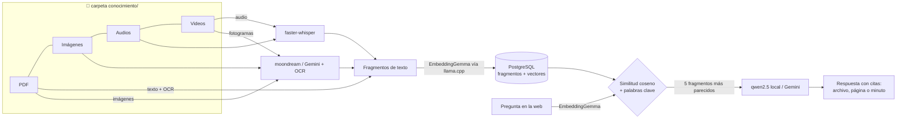

# 💬 Multichat

**Sistema experto de consulta semántica sobre una base de conocimiento multimedia.**
Evolución de nuestro *ChatPDF*: ahora no solo lee PDF, sino que entiende **imágenes**, **audios** y **videos cortos**,
y permite hacerles preguntas en lenguaje natural desde una aplicación web.

> Parcial de Sistemas Expertos · Noveno semestre
> **Integrantes:** Isabel Cerón Sabogal · Jenser Ordóñez García
> 🎥 Video de demostración: _(pega aquí el enlace de YouTube)_

---

## ¿Qué hace?

| Tipo de archivo | Cómo lo entiende Multichat | Qué le puedes preguntar |
|---|---|---|
| 📄 **PDF** | Texto por página (PyMuPDF) + OCR de páginas escaneadas (Tesseract) | "¿Cuántos paneles necesita una casa?" → responde citando la página |
| 🖼 **Imágenes dentro de los PDF y fotos** | Cada imagen se describe con un modelo de visión (moondream o Gemini) y se lee su texto con OCR | "¿Hay alguna imagen de un carro rojo?" · "¿Qué muestra la gráfica?" |
| 🎧 **Audios** (mp3, wav, m4a…) | Transcripción con marcas de tiempo (faster-whisper, local) | "¿Qué dicen en el podcast sobre reciclar baterías?" → con el minuto exacto |
| 🎬 **Videos cortos** (mp4, mov…) | Transcripción de lo que se **dice** + fotogramas descritos por IA (lo que se **ve**) | "¿En qué minuto se conecta el cable?" → botón ▶ que salta a ese minuto |

### ✨ Extras
- **🧠 Así pensó Multichat:** cada respuesta muestra sus pasos: la pregunta, su vector de EmbeddingGemma, la búsqueda en PostgreSQL con los tiempos, la similitud de cada fragmento y un mini mapa de la galaxia.
- **🎙️ Voz:** se puede preguntar hablando (Whisper pasa la voz a texto) y escuchar la respuesta con el botón 🔊.

La búsqueda es **semántica**: encuentra fragmentos por su *significado*, aunque la pregunta no use las mismas palabras
que el documento. Todos los fragmentos de todos los formatos quedan en el **mismo espacio vectorial**, así que una sola
pregunta puede encontrar la respuesta en un PDF, en una imagen y en un video a la vez.

## Tecnologías

| Pieza | Tecnología |
|---|---|
| Embeddings | **EmbeddingGemma-300M** (Google) en formato GGUF, servido con **llama.cpp** (`llama-server --embeddings`). Respaldo: el mismo modelo en Ollama |
| Base de datos | **PostgreSQL 17**: fuentes, fragmentos, embeddings, ajustes e historial del chat. Usa **pgvector** si está instalado; si no, guarda los vectores como `real[]` y calcula la similitud coseno con NumPy |
| Modelo que responde | **Local:** `qwen2.5:1.5b` en Ollama, o cualquier modelo de chat GGUF en llama.cpp · **Nube:** Gemini por API (gratis) |
| Visión | `moondream` (local, Ollama) o Gemini (nube) |
| Audio → texto | `faster-whisper` (local, CPU) o Gemini (nube) |
| OCR | Tesseract (español + inglés) |
| Backend / Web | Python · FastAPI · HTML + JavaScript (sin frameworks) |

Pensado para un PC **sin tarjeta gráfica** (probado en un Intel Core i5 con 12 GB de RAM).

## Arquitectura



1. **Indexación** (botón *Indexar carpeta* o al arrancar): cada archivo nuevo o modificado de `conocimiento/` se convierte
   en fragmentos de texto (con su página o su minuto), se calcula su embedding con EmbeddingGemma y se guarda en PostgreSQL.
   Si un archivo no cambió (mismo SHA-1), no se vuelve a procesar.
2. **Consulta**: la pregunta se convierte en vector con EmbeddingGemma (con el prefijo `task: search result | query:`),
   se buscan los fragmentos más parecidos (similitud coseno) y se refuerzan los que contienen las palabras clave.
3. **Respuesta**: el modelo redacta usando solo esos fragmentos y cita la fuente: `[manual.pdf, pág. 2]` o `[clase.mp3, 00:35]`.
   En la página se ven las fuentes: la página del PDF con el texto resaltado, la imagen, o el audio/video listo para reproducir desde ese minuto.

### Tablas en PostgreSQL

| Tabla | Contenido |
|---|---|
| `sources` | Un registro por archivo de la base de conocimiento: ruta, tipo (pdf, audio, video, imagen), SHA-1, páginas, duración y estado |
| `chunks` | Fragmentos: tipo (`texto`, `imagen`, `transcripcion`, `escena`), página o segundo inicial, contenido y su **embedding** (768 dimensiones) |
| `settings` | Ajustes elegidos en la página (proveedores y modelos) |
| `messages` | Historial del chat con las fuentes de cada respuesta |

## Instalación (Windows)

Requisitos: **Python 3.10+** (marca *Add Python to PATH*), **PostgreSQL** (con la contraseña del usuario `postgres`),
**Ollama** (para los modelos locales), **Tesseract** (OCR) y **ffmpeg** (solo para crear los ejemplos).

1. Clona o descarga este repositorio.
2. Haz doble clic en **`iniciar.bat`**. La primera vez:
   - crea el entorno de Python e instala las librerías,
   - abre el archivo `.env`: cambia `TU_CONTRASENA` por la contraseña de PostgreSQL y guarda (evita los símbolos `@ : / #` en la contraseña),
   - descarga **llama.cpp** y **EmbeddingGemma-300M (GGUF)** y enciende el servidor de embeddings en el puerto 8081,
   - descarga `qwen2.5:1.5b` y `moondream` en Ollama,
   - crea sola la base de datos `multichat` y sus tablas.
3. Se abre **http://localhost:8000**.

Para crear los **audios y videos de ejemplo** (con la voz en español de Windows), haz doble clic en **`crear_ejemplos.bat`**
y luego pulsa **Indexar carpeta** en la página.

### Usar un modelo en la nube (opcional)
En **⚙ Ajustes** elige *Gemini* como modelo que responde, para mirar imágenes o para transcribir, y pega una clave
gratuita de [Google AI Studio](https://aistudio.google.com) → *Get API key*. Solo se envía a la nube lo que elijas.

### Activar pgvector (opcional)
Funciona sin pgvector. Si instalas la extensión `vector` en PostgreSQL **antes de la primera ejecución**,
Multichat la detecta y guarda los embeddings como `vector(768)`, y la búsqueda la hace PostgreSQL con el operador `<=>`.

## Uso

- **📁 Base de conocimiento**: copia archivos en `conocimiento/` (subcarpetas `pdfs`, `audios`, `videos`, `imagenes`) y pulsa
  **Indexar carpeta**, o súbelos con **＋ Subir**.
- **💬 Responder**: la IA responde citando la fuente.
- **🔎 Solo buscar**: muestra los fragmentos más parecidos con su similitud (útil para ver la búsqueda semántica en acción).
- **Filtros**: Todo · PDF · Imágenes · Audios · Videos.

## Estructura del proyecto

```
app/
  main.py      API web (FastAPI): indexar, subir, consultar, servir archivos
  indexer.py   Procesa PDF, imágenes, audios y videos → fragmentos con embedding
  rag.py       Búsqueda semántica híbrida y armado del prompt
  galaxy.py    Galaxia del conocimiento: proyección PCA de los embeddings a 2D
  ai.py        EmbeddingGemma (llama.cpp / Ollama), chat (Ollama / llama.cpp / Gemini), visión y Whisper
  db.py        PostgreSQL (con o sin pgvector)
  pdf.py       Lectura de PDF y página con resaltado
  ocr.py       Tesseract
  config.py    Configuración (.env)
static/index.html   Aplicación web
conocimiento/       Base de conocimiento (PDF, imágenes, audios, videos)
ejemplos/           Material para generar los audios y videos de ejemplo
iniciar.bat         Instala y arranca todo
crear_ejemplos.bat  Crea los audios y videos de ejemplo
```
